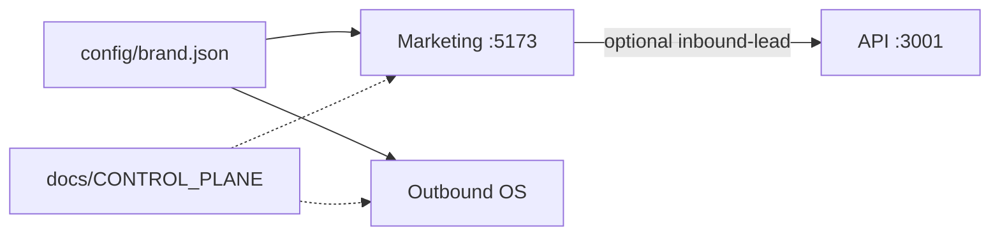

# Halloway Associates

**Greek startup** · https://hallowayassociates.com · jadisselantaki@hallowayassociates.com  

Mission: help everyone get the maximum opportunity from their businesses.  
**Primary product:** Niche Digital Portfolios (`/portfolios/influencers` live) + consulting.  
Studio shell is thin — kits are the proof.

French-first · EUR · desktop-first.

> **Agents:** read [`AGENTS.md`](AGENTS.md) + [`docs/CONTROL_PLANE.md`](docs/CONTROL_PLANE.md) first.  
> **Outreach:** [`docs/business/LAUNCH_SWITCH.md`](docs/business/LAUNCH_SWITCH.md) = **OFF** (dry-run only).

---

## Apps

| Path | Role | Local |
|------|------|-------|
| **Root** | Marketing site, demos, carte | http://localhost:5173 |
| [`outbound-os/`](outbound-os/) | Outbound OS (leads → sequences → dry-run) | UI :5174 · API :3001 |
| [`config/brand.json`](config/brand.json) | **Brand source of truth** | — |
| [`docs/business/`](docs/business/) | Business OS | — |



---

## Quickstart (< 10 minutes)

**Need:** Node 20+, Docker Desktop (for OS DB).

```bash
# Marketing
cp .env.example .env   # optional VITE_OUTBOUND_API_URL=http://localhost:3001
npm install
npm run dev            # :5173

# Outbound OS (separate terminals)
cd outbound-os
cp .env.example .env && cp .env server/.env
npm install
npm run db:up && npm run db:migrate && npm run db:seed
npm run dev:server     # :3001
npm run worker
npm run dev            # UI :5174

# Governance gate (from repo root)
npm run verify
```

**Env:** root `.env.example` = site · `outbound-os/.env.example` = API/UI (copy to `.env` + `server/.env`). Details: [`docs/ARCHITECTURE.md`](docs/ARCHITECTURE.md).

OS login defaults: see `outbound-os/server/.env` (`OPERATOR_EMAIL` / `OPERATOR_PASSWORD`).  
Keep **`DRY_RUN=true`**.

---

## Control docs

| Doc | Why |
|-----|-----|
| [`docs/CONTROL_PLANE.md`](docs/CONTROL_PLANE.md) | Ownership + agent rules |
| [`docs/IDENTITY.md`](docs/IDENTITY.md) | Company identity |
| [`docs/ARCHITECTURE.md`](docs/ARCHITECTURE.md) | Real architecture |
| [`docs/INTEGRATIONS.md`](docs/INTEGRATIONS.md) | Connected vs stub |
| [`docs/AUDIT_MULTI_AGENT.md`](docs/AUDIT_MULTI_AGENT.md) | Multi-agent inventory |
| [`docs/KNOWN_CONFLICTS_RESOLVED.md`](docs/KNOWN_CONFLICTS_RESOLVED.md) | Decisions log |
| [`docs/DEFINITION_OF_DONE.md`](docs/DEFINITION_OF_DONE.md) | CONTROL_ESTABLISHED gate |
| [`docs/business/00_INDEX.md`](docs/business/00_INDEX.md) | Business OS hub |
| [`docs/business/EXECUTIVE_ONE_PAGER.md`](docs/business/EXECUTIVE_ONE_PAGER.md) | Monday one-pager |
| [`docs/DEPLOY.md`](docs/DEPLOY.md) | Vercel + Render |
| [`docs/QUALITY_AUDIT.md`](docs/QUALITY_AUDIT.md) | Quality gate |

Quarantine: [`_archive/`](_archive/)

---

## Compliance

Not a spam tool. Suppressions + unsubscribe in OS. No mass DM / cold SMS. Follow GDPR / ePrivacy / local law before any unlock.
