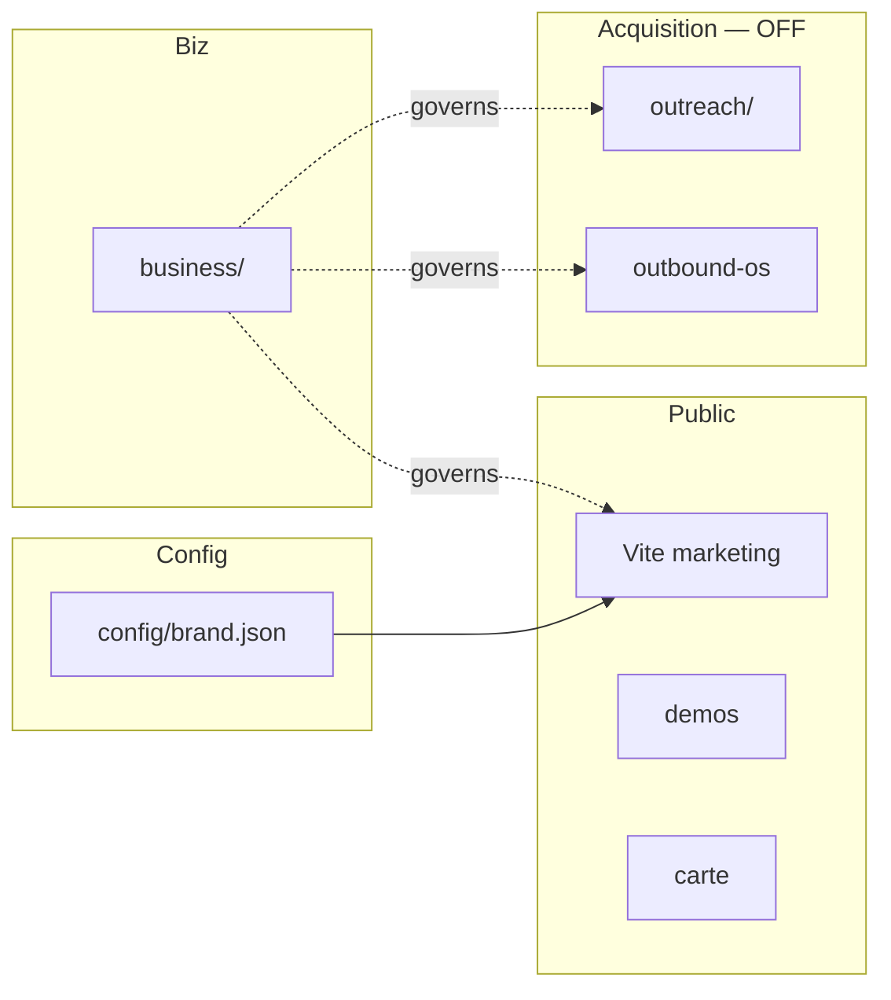

# 14 — Tech map ↔ métier

| Couche | Path | Notes |
|--------|------|-------|
| Marque runtime | `config/brand.json` | Source éditable |
| UI | `src/` | Préserver |
| Qualité | `docs/QUALITY_*` | Technique |
| Métier | `business/` | Ce cadre |
| Vente assets | `outreach/` | Dormant |
| Ops email | `outbound-os/` | Dry-run |

## Ports locaux

| App | Port |
|-----|------|
| Marketing | 5173 |
| Outbound UI | 5174 |
| Outbound API | 3001 |
