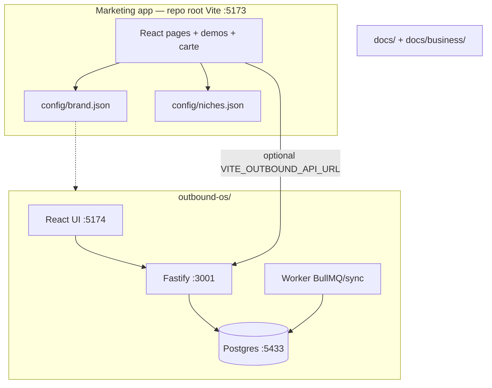

# ARCHITECTURE — as built (not aspirational)

| Meta | Value |
|------|--------|
| **Purpose** | Describe the real system after multi-agent work. |
| **Owner** | Main agent / Founder |
| **Last updated** | 2026-10-31 |
| **Status** | `active` |

**Layout model:** multi-app workspace (not a formal npm workspaces monorepo at root). Root = marketing. `outbound-os/` = nested workspace (web + server). Package manager: **npm** everywhere.

---

## Top-level map

```
Marketing/                          ← workspace root (npm)
├── src/                            Marketing React site
├── public/                         Static assets + carte print
├── config/                         brand.json · niches.json (SoT)
├── docs/                           Control plane + business OS
│   └── business/                   Strategy / SOPs / ICP narrative
├── outreach/                       Email/DM templates only (LOCKED)
├── outbound-os/                    Nested npm workspace (API + UI + worker)
├── scripts/                        verify-project.mjs
├── _archive/                       Quarantined duplicates
├── AGENTS.md                       Hard rules for Cursor agents
├── .env.example                    Marketing env template
└── package.json                    name: halloway-associates
```

| Path | Owns |
|------|------|
| `src/` + `public/` | Public marketing + demos |
| `config/` | Brand + ICP machine data |
| `docs/` | Control + architecture + business |
| `outbound-os/` | Outbound product only |
| `outreach/` | Copy kits (no send) |
| `_archive/` | Dead / superseded trees |

---

## Runtime diagram



## Apps

| App | Stack | Scripts |
|-----|-------|---------|
| Marketing | React 19 + Vite 6 | root `npm run dev` / `build` / `verify` |
| Outbound web | React + Vite + Tailwind + RQ | `outbound-os` workspace `web` |
| Outbound API | Fastify + Zod + Prisma | `npm run dev:server` |
| Worker | BullMQ or SYNC_JOBS | `npm run worker` |

## Env strategy (one workflow)

| App | Template | Local copies (gitignored) |
|-----|----------|---------------------------|
| Marketing | **`.env.example`** (repo root) | `.env` |
| Outbound OS | **`outbound-os/.env.example`** | `outbound-os/.env` **and** `outbound-os/server/.env` (same content) |

Rules:

1. Brand defaults live in `config/brand.json`; env overrides win when set.  
2. Never commit secrets.  
3. Keep `DRY_RUN=true` until `docs/business/LAUNCH_SWITCH.md` = ON (founder only).  
4. Marketing needs `VITE_OUTBOUND_API_URL` only when wiring forms to the OS API.

## ICP / niches

| Layer | Path | Role |
|-------|------|------|
| **Canonical data** | `config/niches.json` | 100 niches · `flagship_id: influencers` |
| Site reader | `src/lib/niches.js` | Import JSON only — do not fork arrays |
| Narrative doc | `docs/business/ICP_100_NICHES.md` | Human render / strategy |
| Outreach copy | `outreach/emails/FR-influencer.md` | Templates LOCKED |

Do **not** recreate `business/04-icp/` or parallel niche JSON files.

## Data

- Marketing forms → localStorage CRM-lite and/or `POST /api/public/inbound-lead`
- OS: Lead, Campaign, Sequence, Outbox, Pipeline, Suppression (Prisma)

## Deploy (see DEPLOY.md)

- Marketing → Vercel  
- API/worker → Render (or similar)  
- DB → Postgres (Docker locally)

## Locked

Outbound live send gated by `docs/business/LAUNCH_SWITCH.md`.
