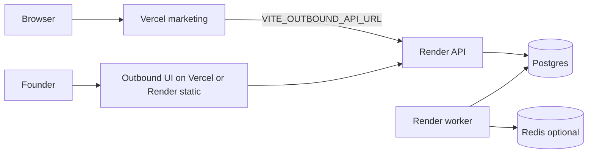

# Deploy — Marketing site + Outbound OS

Zero secrets in git. Use host dashboards / CLI secrets only.  
**Free-first catalog:** [`INTEGRATIONS_CATALOG.md`](INTEGRATIONS_CATALOG.md) · status [`../config/integrations.status.json`](../config/integrations.status.json).

**Already provisioned (free):**

| Resource | ID / name |
|----------|-----------|
| Vercel project | `halloway-associates` on **jadissels-projects** (`prj_kPi2KBROErSQLIIbtkZ9UGkcAMwH`) · prod alias `https://halloway-associates-alpha.vercel.app` (legacy empty project on Dina team: `prj_MBjbCDnexhNtYdziZMUZL4qRExfh`) |
| Neon project | `halloway-associates` (`summer-river-76359085`) |

## Architecture (production)

| Layer | Host | Notes |
|-------|------|--------|
| Marketing site | **Vercel** | Root Vite app (`npm run build`) |
| Outbound API + worker | **Render** | Two services from `outbound-os/server` (or one web + one worker) |
| Postgres | **Neon** or Render Postgres | Set `DATABASE_URL` (pooled OK for API) |
| Redis | **Upstash** or Render Redis | Or `SYNC_JOBS=true` (in-process outbox poll) |

---

## 1) Marketing → Vercel

1. Import the repo; **Root Directory** = repo root (not `outbound-os`).
2. Build: `npm install && npm run build` · Output: `dist`
3. Env (Production):

| Variable | Value |
|----------|--------|
| `VITE_SITE_URL` | `https://hallowayassociates.com` (or custom domain) |
| `VITE_COMPANY_NAME` | from `config/brand.json` |
| `VITE_CONTACT_EMAIL` | founder email |
| `VITE_FOUNDER_NAME` / `VITE_CITY` / `VITE_PHONE` / `VITE_INSTAGRAM` | as needed |
| `VITE_OUTBOUND_API_URL` | `https://YOUR-API.onrender.com` |
| `VITE_FORMSPREE_ID` | optional |
| `VITE_ADMIN_PIN` | strong PIN |

4. Domain: point DNS to Vercel; carte QR already uses `brand.absoluteUrl('/audit')` → `{{SITE_URL}}/audit`.

CORS: API must allow the Vercel domain in `CORS_ORIGIN`.

---

## 2) Outbound API → Render

1. **Web service** from `outbound-os/server`:
   - Build: `npm install && npx prisma generate && npm run build`
   - Start: `npm run start` (binds `0.0.0.0:$PORT`)
   - Health: `GET /api/health`
2. **Worker** (Background Worker):
   - Same build
   - Start: `npm run start:worker`
3. Env (required):

| Variable | Notes |
|----------|--------|
| `DATABASE_URL` | Neon/Render Postgres |
| `JWT_SECRET` | long random (≥24) |
| `OPERATOR_EMAIL` / `OPERATOR_PASSWORD` | change defaults |
| `DRY_RUN` | keep `true` until [`GO_LIVE_CHECKLIST.md`](GO_LIVE_CHECKLIST.md) |
| `CORS_ORIGIN` | `https://hallowayassociates.com,https://YOUR-OS-UI.vercel.app` |
| `UNSUBSCRIBE_BASE_URL` | `https://YOUR-API.onrender.com/api/public/unsubscribe` |
| `BRAND` / `FOUNDER_*` / `CONTACT_*` / `SITE_URL` | mirror `config/brand.json` |
| `WEBHOOK_SECRET` | required when `NODE_ENV=production` for email webhooks |
| `REDIS_URL` + `SYNC_JOBS` | Redis URL or `SYNC_JOBS=true` |
| `RESEND_API_KEY` / SMTP_* | only when going live |

4. Run migrate once: `npx prisma migrate deploy` (release command or one-off).
5. Seed optional: `npm run db:seed` (dev/staging only).

---

## 3) Outbound UI

Option A: second Vercel project with Root Directory `outbound-os/web`, build `npm install && npm run build`, env proxy or absolute API URL.  
Option B: serve `web/dist` from same Render static site.  
Dev default: http://localhost:5174 → proxies `/api` to :3001.

---

## 4) Post-deploy smoke

1. `GET https://API/api/health` → ok  
2. Marketing `/audit` with `VITE_OUTBOUND_API_URL` set → lead in OS Pipeline  
3. OS login → dry-run campaign still works  
4. See [`E2E_VERIFY.md`](E2E_VERIFY.md)
