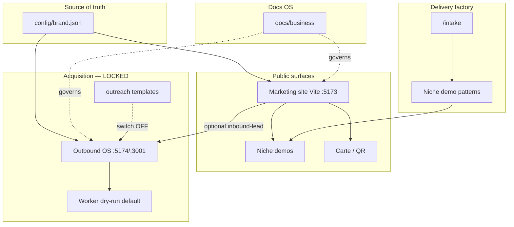

# 09 — Technical architecture

| Meta | Value |
|------|--------|
| **Purpose** | Map systems, environments, data ownership, readiness, kill-switch. |
| **Owner role** | Delivery / Growth systems · CEO for switch |
| **Last updated** | 2026-10-31 |
| **Status** | `active` |
| **Non-goals** | New microservices; launching acquisition; large refactors. |

---

## System map

| System | Path | State |
|--------|------|-------|
| Marketing site | `/` `src/` | Production-capable |
| Demo sites | `/demos/*` | Production-capable |
| Carte | `/carte`, `public/card/` | Production-capable |
| Brand config | `config/brand.json` | **SoT** |
| Business OS | `docs/business/` | Active docs |
| Outreach copy | `outreach/` | Staged / locked send |
| Outbound OS | `outbound-os/` | Dry-run ready; live locked |
| CRM-lite | `/admin/leads` | Local only |
| Delivery templates | demos + SOPs | Staged factory |

---

## Environments

| Env | Marketing | Outbound OS |
|-----|-----------|-------------|
| Local | `npm run dev` :5173 | UI :5174 · API :3001 · Docker DB |
| Preview | Vercel preview | Optional Render preview |
| Production | hallowayassociates.com | Separate host when needed |

---

## Brand source of truth

1. `config/brand.json`  
2. `src/lib/brand.js` (reads JSON + `VITE_*` overrides)  
3. Outbound env brand fields should stay aligned  

---

## Data entities (conceptual → code)

| Entity | Meaning | Today |
|--------|---------|--------|
| **Lead** | Prospect pre-sale | `localStorage` CRM-lite; OS `Lead` table; `POST /api/public/inbound-lead` |
| **Client** | Paying customer | Folder on disk (not full CRM entity yet) |
| **Project** | One kit delivery | Implicit in client folder + WIP notes |
| **Invoice** | Money document | Manual numbering HA-YYYY-NNNN |
| **Campaign / Outbox** | Outreach | OS only — **dry-run** |
| **Suppression** | Do-not-contact | OS enforced |

Implementation debt: no unified Client/Project DB on marketing app — acceptable pre-GTM.

---

## Security / compliance baseline

- No secrets in git (`.env` gitignored)  
- OS auth on write routes; webhook secret in prod  
- Public forms rate-limited when hitting OS  
- Minimal PII logging; `LOG_EMAIL_BODIES=false`  
- Legal stubs on site — lawyer review before scale  

---

## Backup / deploy responsibilities

| Asset | Owner hat | Practice |
|-------|-----------|----------|
| Git repo | Delivery | Push often |
| Brand JSON | CEO | Review before deploy |
| Production site | Delivery | Vercel (or current host) |
| OS DB | Growth systems | Postgres backups when prod |
| Client folders | Ops | Local encrypted drive |

---

## Kill-switch

Outbound sending remains **dry-run default**.  
Human control: [`LAUNCH_SWITCH.md`](LAUNCH_SWITCH.md) = OFF.  
Do not set `DRY_RUN=false` while switch OFF.
