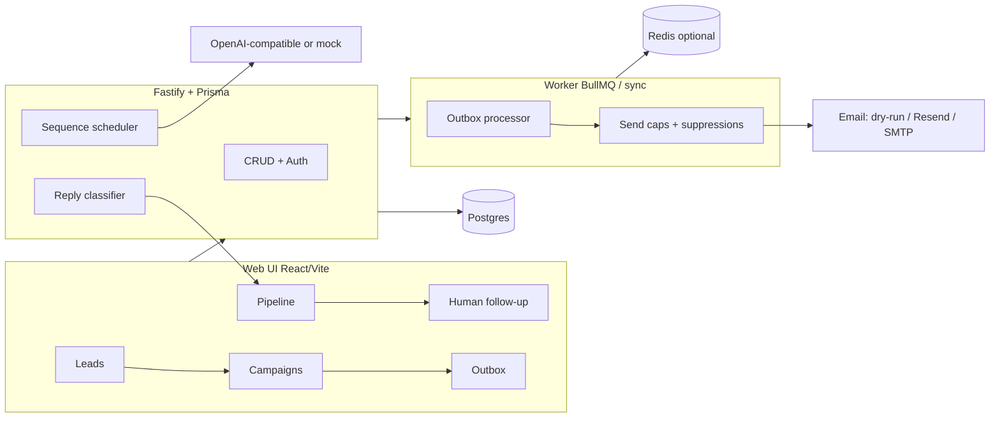

# Halloway Associates — Outbound OS

> **LAUNCH = OFF** for acquisition — [`LAUNCH_STATUS.md`](LAUNCH_STATUS.md). Keep `DRY_RUN=true`.  
> Business framework: [`../business/`](../business/).

Internal **desktop-first** tool to find local SMB leads, enrich contacts, generate personalized French email sequences, send with caps (or dry-run), classify replies, and hand warm leads to a human pipeline.

> **Compliance:** Operators must follow GDPR, ePrivacy, CAN-SPAM, and local law. This is **not** a spam cannon, CAPTCHA-bypass scraper, cold SMS/WhatsApp blaster, or social auto-DM bot. LinkedIn/Instagram = copy only (manual/assisted). Every email includes an unsubscribe link. Global suppressions are enforced server-side.



## Quickstart (one path)

**Requirements:** Node 20+, Docker Desktop.

```bash
cd outbound-os
cp .env.example .env
cp .env server/.env
npm install
npm run db:up
# wait a few seconds for Postgres on :5433
npm run db:migrate
npm run db:seed
```

> Prisma CLI reads `server/.env`. Keep root `.env` and `server/.env` in sync (or only maintain `server/.env`).

Then in **three terminals** (or use `npm run dev:all` for web+api+worker):

```bash
npm run dev:server   # API :3001
npm run worker       # outbox drain
npm run dev          # UI  :5174 (marketing site uses :5173)
```

Login:

- Email: `jadisselantaki@hallowayassociates.com` (or `OPERATOR_EMAIL`)
- Password: `change-me-now` (or `OPERATOR_PASSWORD`)

Happy path:

1. **Leads** → Découvrir (mock) for « coiffeurs / Lyon »  
2. Select leads → add to campaign (or open seeded paused campaign)  
3. **Campagnes** → Démarrer (dry-run) → Traiter outbox  
4. **Pipeline** → paste a positive reply → see **Chaud**  
5. **Suppressions** → confirm unsubscribes never re-contact  

## Dry-run vs live

| Mode | How | Behavior |
|------|-----|----------|
| **Dry-run (default)** | `DRY_RUN=true` and/or mailbox `dry_run` | Messages composed, stored, marked `dry_run_sent`. No provider call. |
| **Live Resend** | `DRY_RUN=false`, `EMAIL_PROVIDER=resend`, `RESEND_API_KEY=…` | Real sends with idempotency key. |
| **Live SMTP** | `DRY_RUN=false`, `EMAIL_PROVIDER=smtp`, SMTP_* | Nodemailer send. |

UI shows a **Mode dry-run** badge when dry-run is active.

## Environment

Copy `.env.example` → `.env`. Never commit secrets.

Important vars: `DATABASE_URL`, `REDIS_URL`, `SYNC_JOBS`, `OPERATOR_*`, `JWT_SECRET`, `DRY_RUN`, brand placeholders (`BRAND`, `FOUNDER_NAME`, `CITY`, `CONTACT_EMAIL`, `CONTACT_PHONE`), `RESEND_API_KEY`, `OPENAI_API_KEY`, SMTP_*.

If Redis is down, set `SYNC_JOBS=true` — jobs run in-process; the worker still polls the outbox.

## Scripts

| Script | Purpose |
|--------|---------|
| `npm run db:up` | Postgres + Redis via docker-compose |
| `npm run db:migrate` | Prisma migrate deploy + generate |
| `npm run db:seed` | Operator, mailbox, 5 FR sequences, 50 leads, sample campaign |
| `npm run dev` / `dev:server` / `worker` | UI / API / worker |
| `npm test` | Unit tests (caps, classifier, templates) |
| `npm run test:e2e` | Playwright smoke (API must be up) |

## Architecture notes

- **Auth:** password gate + JWT (finished MVP; no Clerk required to boot).  
- **Providers:** email + AI + lead discover abstracted; mocks keep demos offline.  
- **Statuses:** campaign/lead/outbox transitions enforced in API + worker.  
- **Webhooks:** `POST /api/webhooks/email-events` + public unsubscribe GET.  
- **Non-goals:** Instagram/LinkedIn auto-DM, cold SMS, deal auto-close, public marketing site (see `docs/OUTREACH_COPY.md`).

## Replace placeholders

Edit **Paramètres** in the UI or `.env` (`BRAND`, `FOUNDER_NAME`, `CITY`, `CONTACT_EMAIL`, `CONTACT_PHONE`). Templates use `{{…}}` tokens rendered at enqueue time.

## Layout

```
outbound-os/
  docker-compose.yml
  .env.example
  server/          Fastify + Prisma + worker
  web/             React + Vite + Tailwind
  docs/OUTREACH_COPY.md
  e2e/             Playwright smoke
```

Built beside the Halloway Associates marketing site (https://hallowayassociates.com); this folder is the outbound product.
